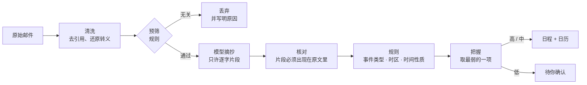

# 准点 · InterviewTrack

**把招聘邮件变成一张可以放心照着做的日程，按你所在的时区。** 给在海外找国内工作的留学生做的：北京时间 13:30 的面试，在你这里显示成凌晨 01:30；前一天晚上收到一封带会议链接的提醒邮件，开始前 30 分钟日历响一下。它读投递回执、测评邀请、面试通知和拒信，判断每一封「是什么事」「什么时候」「哪个时区」，排进看板。拿不准的时候，它会直说，而不是猜一个。

**直接用：** https://board.interviewtrack.me （公开内测，名额有限；邮箱验证码登录）
**在线演示：** https://job-command-center-eta-two.vercel.app （公司和邮件全部虚构，解析都在浏览器里完成）


[English](./README.en.md)

## 为什么做这个

秋招期间每周几十封邮件，中英文混着，跨四个时区。代价最高的错误很具体：

- 把**固定场次**当成截止时间 → 错过考试
- 把**截止时间**当成固定场次 → 白等一场不存在的考试
- 时间显示成**错的时区** → 差 12 个小时
- 把「邀请于 09:09 生效」当成考试时间 → 邮件一到，看板就显示「已逾期」

直接让大模型「把时间抽出来」，这四种错它都会犯，而且很自信。所以目标不是「抽得越多越好」，而是**绝不显示一个错的时间**。

## 核心设计：模型只摘抄，规则做决定

模型只允许从原文里**逐字摘出片段**：公司名、岗位、说时间的那句话、地点、对事件类型的建议。它不输出日期，不输出时区，不做任何决定。



会伤到用户的判断全部交给确定性规则，规则可以逐条读、逐条测、逐条改：

| 判断 | 谁来做 | 为什么 |
|---|---|---|
| 公司 / 岗位 / 哪句话在说时间 | 模型 | 规则不擅长自由格式的名字，模型擅长 |
| 这个片段真的在原文里吗 | 规则（核对） | 挡住编出来的日期和地点 |
| 固定场次、截止时间，还是只有日期 | 规则 | 代价最高的错，必须说得清理由 |
| 时区 | 规则，只认明确的证据 | 不从语言推断，不给默认值 |
| 和之前那封是不是同一件事 | 规则（去重键） | 提醒信并进原来那条，不重复出现 |
| 要不要排进日程 | 规则（把握） | 「拿不准」是正常结果，不是失败 |

由此得到两条性质：

1. **模型只有否决权，没有提名权。** 模型和规则对「这是什么事」看法不同时，这件事进「待确认」。模型能把一件事拦在日程外面，但不能把任何一件事送进日程。
2. **每个结论都能解释。** 每张卡片的详情里有高亮的原文片段，以及每一步判断的依据。

## 真实邮件上的结果

在我自己的 147 封招聘邮件上测得（流程邮件 92 封、岗位广告 50 封、无关 5 封）。方法和注意事项见 [docs/EVALUATION.md](./docs/EVALUATION.md)。

| | 只用规则 | 规则+模型（首次） | 规则+模型（修复后） | + 群发过滤 |
|---|---|---|---|---|
| **精确率**：进日程的条目完全正确的比例（目标 > 95%） | 73.8% | 75.0% | 98.5% | **100%**（67 / 67） |
| **召回率**：流程邮件完全正确且进了日程的比例（目标 > 70%） | 33.7% | 55.4% | 72.8% | **72.8%** |
| 广告/无关邮件错上日程（共 55 封） | 3 | 8 | 1 | **0** |
| 广告/无关邮件进了「待确认」（共 55 封） | 14 | 13 | 11 | **2** |
| 公司名正确（共 92 封） | 59.8% | 98.9% | 98.9% | 98.9% |

**需要说明：**后两列是在同一批 147 封邮件上测的，而修复正是对着这批邮件做的，所以偏乐观。「首次」一列才是没有被污染的数字。群发过滤也有代价：有 2 封原本停在「待确认」的流程邮件，现在被当成群发折叠了（见 [docs/EVALUATION.md](./docs/EVALUATION.md)）。

「首次」那一列最有意思：加上模型后公司名几乎全对了（60% → 99%），精确率却几乎没动。原因是原来因为「没有公司名」被拦住的条目，现在连同它们别的错误一起被放进了日程。「模型只有否决权」这条规则就是这么来的。

### 没见过的新邮件（2026-11-10，第一次）

拿线上产品实际存下的结论对答案：我自己账号 10 月 16 日到 11 月 10 日收到的 76 封，先盲标答案再比对。

| | 规则定稿之后才收到的（真正没见过，15 封） | 全部 76 封 |
|---|---|---|
| 进日程的条目完全正确 | 5 / 5 | 18 / 18 |
| 流程邮件完全正确且进了日程 | 5 / 9（55.6%） | 18 / 30（60.0%） |
| 广告/无关邮件错上日程 | 0 / 6 | 0 / 46 |
| 确切时刻正确 | 5 / 5 | 15 / 15 |

**这组数字要打折看：**真正没见过的只有 15 封，样本太小，下不了结论；被第一道筛选直接丢掉、没存下来的信不在样本里；还是同一个邮箱、同一个人。它说明的是方向：没有显示错的时间，但召回率比样本内的 72.8% 低，没进日程的那些都停在「待确认」。这次暴露的 3 个类型判错已经修掉（见下面「仓库和线上的关系」）。

## 演示里能看到什么

| 视图 | 内容 |
|---|---|
| 今天 | 下一件事和倒计时、48 小时内要做的、该跟进的。 |
| 日程 | 一件事一张卡片：公司、岗位、按你时区的时间，测评链接 / 会议号直接在卡片上。可以标完成；时间过了没标的会问你「做了吗」，不自动算完成。 |
| 日历 | 同样的条目放在月历上，按你当地的日期。 |
| 待确认 | 系统不肯猜的条目，每条用大白话写明为什么拿不准：排进日程、只记录、忽略，或者标成广告。可批量处理。 |
| 投递 | 一家公司一行，状态由邮件推断（回执和结果只记在这里），可编辑；可批量「已跟进，7 天后再看」。手机上是卡片。 |
| 统计 | 漏斗、状态分布、未来两周、每周邮件量、系统自己处理了多少。 |
| 邮件 | 所有邮件，最新在前；广告、验证码折叠在下面并写明原因；删除的进回收站可恢复。 |
| 设置 | 看板替你记住了什么（屏蔽的发件人、改过的公司名、确认过的时区），每条都能删。 |

所有视图通用：任何一条都能编辑（原邮件不会被改）、撤销上一步（按钮或 Ctrl/Cmd+Z）、搜索、撤不回来的操作要点两下。

演示里是 28 封合成邮件。其中 13 封各对应一种容易出错的情况（固定场次、「72 小时内完成」这类相对期限、「生效时间」陷阱、在香港举行的英文邮件、没有时区的邀请、必须并进原条目的提醒信等）；另外 15 封是三周的普通往来（回执、二面、终面、录用、拒信），让投递表和统计有内容可看。这些样本的模型输出只录了一次，在浏览器里回放，所以公开站点不调用任何接口。

## 线上产品（`worker/`）

演示站只有前端。`worker/` 是 https://board.interviewtrack.me 背后的服务端，跑在 Cloudflare 上（Workers + D1 + Email Routing + Email Service），用的是同一个引擎、同一套看板组件。

| 功能 | 怎么做的 |
|---|---|
| 账号 | 邮箱验证码登录（6 位、10 分钟有效、最多试 5 次；按邮箱和来源限频；没注册的邮箱也回答「已发送」，外人试不出谁有账号），前面有 Cloudflare Turnstile 防机器人。开放注册，有名额上限。每个人的数据分开存，别人看不到。 |
| 收信 | 每人一个专属收信地址。Gmail 用一段过滤条件只转招聘信；QQ、163、Outlook 全部转发，准点按标题、正文、发件系统挑出招聘信，其余当场丢掉，不保存、不交给 AI。转发确认（Gmail 验证码、QQ「接受转发」）直接变成看板上的按钮；手动转发（包括 QQ 一次转多封）会还原成原信。 |
| 时区 | 选「你在哪」和「在哪找工作」，时间按你这里显示，原来的时间在详情里。 |
| 邮件提醒 | 面试、笔试前一天晚上一封（两地时间、链接、考试码、你的备注）；测评截止前 24 小时、3 小时各一封，标了完成就不发。 |
| 日历订阅 | 每人一条 `.ics` 订阅链接，Apple / Google 日历都能用，默认开始前 30 分钟提醒；链接泄露可以换。 |
| AI（可关） | 一句话添加；面试准备（这场面试的邮件 + 你的简历，简历在浏览器里转成文字）。每人每天有额度，关掉后只用规则。 |
| 隐私 | 大白话隐私政策、一键删除账号、登录记录 2 天后删除、每 6 小时自检。 |


部署步骤和安全说明见 [worker/README.md](./worker/README.md)。部署前先把 `worker/wrangler.toml` 里的占位符（域名、邮箱、数据库 id）换成你自己的。

## 仓库和线上的关系

这个仓库是从私有开发库**手动导出**的，不自动同步；最近一次导出是 **2026 年 11 月 16 日**，和当时的线上版本一致。10 月 20 日那次导出之后新增的主要改动：

- **事件类型判得更准**：拒信里出现「面试」两个字不再被当成面试；信里「提到」一个环节不等于「是」那个环节（感谢你参加上一轮测评、回执里一句「笔面试将滚动安排」、做完测评后的提交确认）；面试结束后的评价邀请直接折叠；笔试预通知不再被当成改期。
- **时间更保守**：只知道日期的不再显示一个假钟点，也不再拿「发链接那天」当考试时间。
- **卡片**：链接按用途排（考试入口第一、确认参加其次，练习和须知收进「其他链接」）；日程按时间排，凌晨的场次有标记并带原时间；待确认可以一键放进日程。
- **多设备**：两台设备同时开着看板，保存时会校验版本，不再互相覆盖。
- **日历订阅链接**改为随机生成。
- **测试**：加了一条用真浏览器走一遍登录、确认、标完成、刷新的冒烟测试（`worker/e2e/smoke.mjs`）。

运营者自己用的本地统计工具、导出脚本不在这个仓库里。

## 目录

```
engine/   解析引擎。纯 TypeScript，零运行时依赖，551 个测试
web/      Next.js 应用（即演示站）。引擎以拷贝方式放在 web/lib/tracker-core，176 个测试
worker/   Cloudflare Worker：收信、账号、提醒、日历订阅、AI 接口，以及看板页面（Vite），181 个测试
docs/     评测方法与数字
```

## 运行

需要 Node.js 20.9 或更高版本；worker 的测试要 22.13 以上（用到 node:sqlite）。

```bash
cd engine && npm ci && npm test
cd web && npm ci && npm run dev      # http://localhost:3000
cd worker && npm ci && npm run check # 先装好 web（看板复用它的组件）；类型检查 + 测试 + 构建看板（测试要 Node 22.13+）
```

想用真实模型而不是录好的输出，任何兼容 OpenAI 接口的服务都可以：

```bash
cd web
export LLM_BASE_URL=https://api.deepseek.com/v1 LLM_MODEL=deepseek-v4-pro LLM_API_KEY=...
npx vite-node scripts/record-extractions.ts
```

想在自己的邮箱上给引擎打分，见 `engine/tools/eval-extract.ts` 和 `engine/tools/score-extract.ts`。自己的邮件和输出不要提交进版本库。

## 已知局限

- 样本外验证只做过一次，真正没见过的只有 15 封，召回率 55.6%，样本太小（见上）。还在继续攒。
- 评测只来自一个邮箱、一个人、一个招聘季，答案也没有第二个人独立核对过。
- 这个仓库手动导出，可能落后于线上（见「仓库和线上的关系」）。
- 回执里一句「24 小时内会收到测评邀请」这类「以后才发生」的说法，规则仍可能判成测评；模型不同意时会被拦在「待确认」，但规则本身没修完。
- 演示站没有后端：那里的手动操作存在浏览器本地。服务端在 `worker/`（见上）。
- 内测阶段：名额有上限，验证码和提醒共用发信额度。「全部转发」在 QQ 邮箱上完整走通过；163、Outlook 同理但还没实际走一遍。
- 群发过滤靠标题规则，是对着这批邮件调的；新出现的营销说法会漏，「这是广告」按钮屏蔽发件人兜底。
- 没有任何时区线索的邮件按设计进「待确认」，即使人能从公司猜出时区。
- 同一家公司一封信写英文品牌、一封写中文全称时，会显示成两条，系统目前不会自动认出是同一家。
- 源码注释是中文的，偶尔会提到不在这个仓库里的内部设计笔记。

## 不在这个仓库里的东西

真实邮件、人工真值、以及回放真实邮件的回归测试都留在私有环境。这个仓库只有代码、合成数据和汇总后的评测数字。

我自己部署用的配置（域名、邮箱、数据库 id、密钥）在 `worker/wrangler.toml` 里都换成了占位符。密钥从不进仓库，用 `wrangler secret put` 单独设置。

## 这个项目是怎么做出来的

一个人和 AI 编程助手（Claude）协作完成。产品决策、引擎不可违反的几条铁律、以及每次改动的验收由我负责；大部分代码和真值的初标是和助手一起完成的。这对评测数字意味着什么，见 [docs/EVALUATION.md](./docs/EVALUATION.md)。

## 许可

MIT，见 [LICENSE](./LICENSE)。
